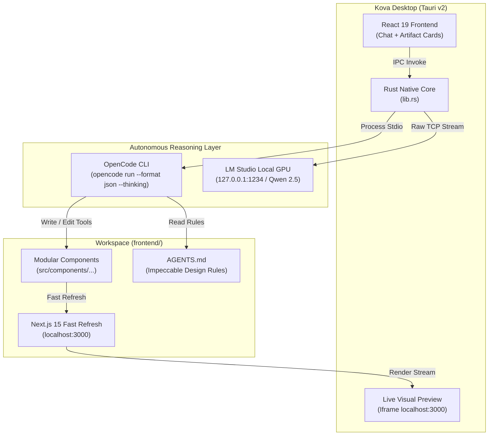

# Kova AI Studio ⚡ Autonomous Website Builder Desktop

> **Turn plain language into production-grade Next.js frontends backed by autonomous reasoning agents, local GPU models, and instant visual live reload.**

[](https://v2.tauri.app/)
[](https://www.rust-lang.org/)
[](https://react.dev/)
[](https://opencode.ai)
[](https://lmstudio.ai/)
[](LICENSE)

---

## 📸 Showcase

### Side-by-Side Autonomous Engineering Workbench


### Production Next.js Live Preview with Impeccable Design


---

## ✨ Features That Make Kova AI Studio Amazing

- **🧠 OpenCode CLI Autonomous Engine Wrapper**  
  Unlike basic chat wrappers that generate single-shot hallucinations, Kova runs the **OpenCode CLI (`opencode-ai`)** autonomously under the hood. It reads directory structures, plans multi-step edits, inspects syntax, and runs recovery loops.
  
- **💭 Real Collapsible Reasoning & Chain-of-Thought**  
  Watch the model think before writing code. Thinking blocks are streamed directly into an expandable **Agent Reasoning** accordion with token telemetry and zero generic responses.

- **⚡ 100% Free & Offline Local GPU Mode (LM Studio)**  
  Connects directly to **LM Studio (`127.0.0.1:1234`)** via raw OS TCP sockets in Rust (bypassing all browser CORS limitations). Run **Qwen 2.5 Coder**, **DeepSeek**, or **Llama 3** locally on your GPU with $0 API bills.

- **🎨 Enforced Impeccable Design Standard**  
  Autonomous skill gating enforces Paul Bakaus's Impeccable Design standard:
  - Deep obsidian canvas (`#09090b` / `bg-zinc-950`)
  - Crisp micro-borders (`border-white/10`)
  - Emerald (`#10b981`) and Amber (`#f59e0b`) accents
  - **Zero generic purple-to-blue AI gradient slop**
  - Smooth hover lifts, glassmorphism cards, and Lucide React icons

- **📱 Integrated Device Viewport Testing**  
  Toggle preview sizes instantly without opening an external browser:
  - **Desktop (100% responsive fluid)**
  - **Tablet (768px portrait)**
  - **Mobile (390px iPhone standard)**

- **🚀 Live Hot-Reload Visual Preview**  
  Next.js Fast Refresh runs side-by-side with your chat. As the agent writes files to disk, your changes appear live instantly on the right.

- **🔌 Headless WordPress & MCP Bridge Ready**  
  Pre-configured to communicate with headless WordPress REST/GraphQL APIs and MCP servers on port `8000`.

---

## 🏗️ Architecture



---

## 🛠️ Prerequisites & Installation

### Requirements:
1. **Node.js**: v18.0 or higher (`pnpm` recommended: `npm install -g pnpm`)
2. **Rust**: Rust & Cargo 1.80+ ([Install Rust](https://www.rust-lang.org/tools/install))
3. **OpenCode CLI**:
   ```bash
   npm install -g opencode-ai
   ```
4. **LM Studio** *(Optional for local offline GPU)*:
   - Download from [lmstudio.ai](https://lmstudio.ai/)
   - Load `qwen2.5-coder-7b-instruct` or any coder model
   - Start Local Server on port `1234`

---

### Step-by-Step Setup:

1. **Clone the repository:**
   ```bash
   git clone https://github.com/gusfing/kova-ai.git
   cd kova-ai
   ```

2. **Install frontend dependencies:**
   ```bash
   pnpm install
   ```

3. **Start the Next.js preview target (in `frontend/`):**
   ```bash
   cd ../frontend
   npm install
   npm run dev
   ```

4. **Launch Kova AI Studio Desktop:**
   ```bash
   # From kova-desktop directory:
   pnpm tauri dev
   ```
   *Or on Windows, simply double-click `launch-desktop.bat`!*

---

## 📊 Project Status & Roadmap

### ✅ Completed & Operational:
- [x] **Tauri v2 Desktop Shell**: High-performance, low-memory Windows native desktop application.
- [x] **OpenCode CLI Headless Wrapper**: Spawns `opencode run` with JSON streaming, automated tool approvals, and AST verification.
- [x] **Collapsible Chain-of-Thought UI**: Interactive accordion that displays the agent's real reasoning before code is written.
- [x] **LM Studio Rust Socket IPC**: Zero-CORS direct TCP bridge to query local GGUF models on port `1234`.
- [x] **Dual Layout Splitter**: Split 50/50, Focus Agent, or Focus Preview mode.
- [x] **Impeccable Design Skill Injection**: `AGENTS.md` guidelines automatically loaded by the autonomous agent.
- [x] **Live Next.js Preview Frame**: Real-time rendering with responsive viewport controls (Desktop/Tablet/Mobile).

---

### 🚧 Work Remaining & Upcoming Features:

| Feature | Description | Status | Priority |
| :--- | :--- | :---: | :---: |
| **Real-time SSE Token Streaming** | Stream individual tokens and tool calls live as they are being typed rather than awaiting batch step finish. | In Progress | 🔴 High |
| **Git Visualizer & History Undo** | Bolt.new-style interactive undo tree allowing users to jump back to any previous commit or prompt turn. | Planned | 🟡 Medium |
| **Headless WordPress Two-Way Sync** | Push generated layouts directly into WordPress Block / Full-Site Editor themes via MCP. | Planned | 🟡 Medium |
| **One-Click Cloud Deployment** | Instant export & edge deployment to Vercel, Netlify, or Cloudflare Pages with SSL. | Planned | 🟢 Low |
| **Multi-Agent Squad Mode** | Specialized autonomous agents (Architect, UI Designer, Security Auditor) debating and collaborating. | Research | 🟢 Low |

---

## 🤝 Contributing

Contributions, issues, and feature requests are welcome!
Feel free to check the [issues page](https://github.com/gusfing/kova-ai/issues).

---

## 📄 License

This project is licensed under the [MIT License](LICENSE).
