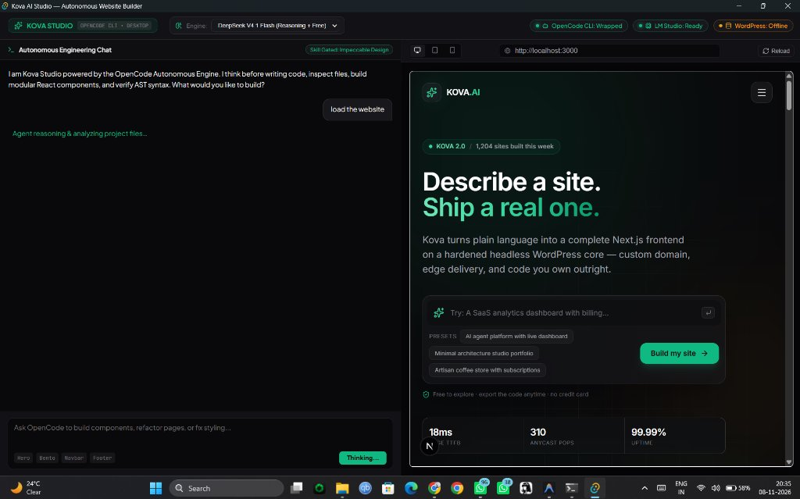
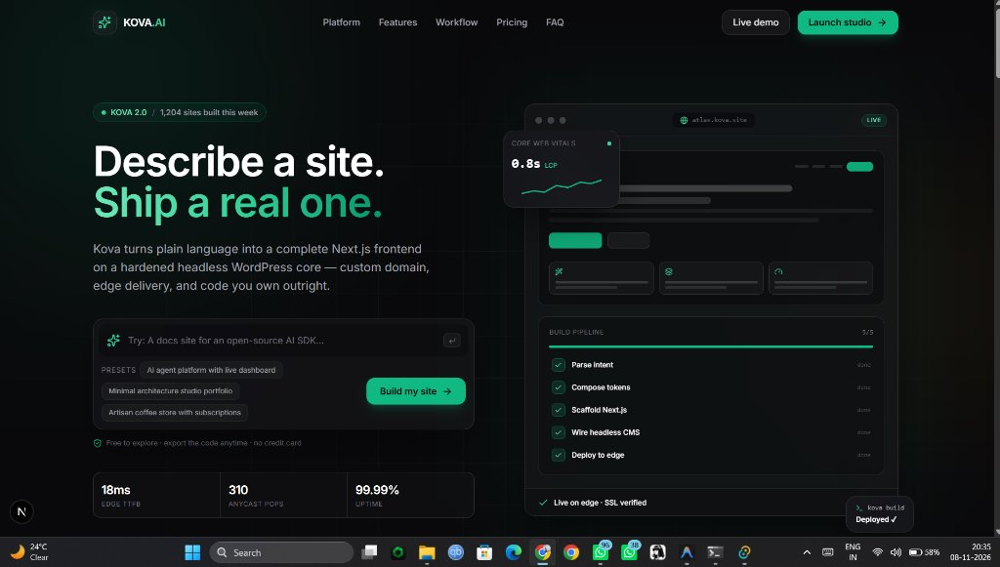
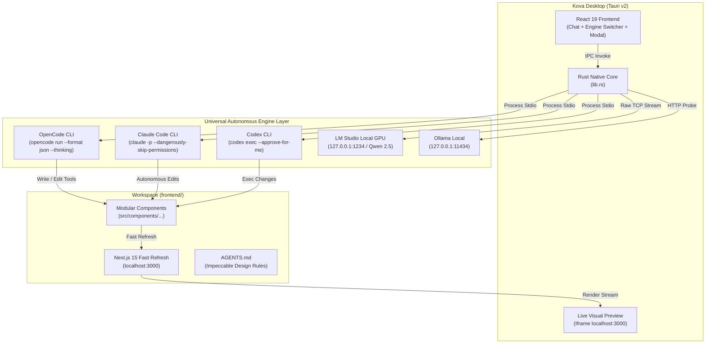

# Kova AI Studio ⚡ Autonomous Website Builder Desktop

> **Turn plain language into production-grade Next.js frontends backed by autonomous reasoning agents, local GPU models, and instant visual live reload.**

[](https://v2.tauri.app/)
[](https://www.rust-lang.org/)
[](https://react.dev/)
[](https://github.com/gusfing/kova-ai)
[](https://lmstudio.ai/)
[](LICENSE)

---

## 📸 Showcase

### Side-by-Side Autonomous Engineering Workbench


### Production Next.js Live Preview with Impeccable Design


---

## ✨ Features That Make Kova AI Studio Amazing

- **🔌 Universal CLI & Local Engine Bridge**  
  Connect any autonomous agent CLI or local model with a single click:
  - **OpenCode CLI**: Headless autonomous runner with AST tool loop, multi-step planning, and free reasoning models (DeepSeek V4.1 Flash, Groq Qwen 3.8, Nemotron).
  - **Claude Code CLI**: Official Anthropic terminal agent (`claude -p` with autonomous permissions).
  - **Codex CLI**: OpenAI Codex non-interactive execution engine (`codex exec`).
  - **LM Studio (Local GPU)**: Direct OS-level TCP bridge (`127.0.0.1:1234`) with zero-CORS access to offline GGUF models.
  - **Ollama**: Local containerized LLMs on port `11434`.

- **⚡ In-Chat Dynamic Model Switcher**  
  Switch engines and models on the fly directly inside the chat toolbar or header. Jump from DeepSeek V4.1 to Claude 3.7 or local Qwen 2.5 Coder in one click without restarting your session.

- **🪄 Kova Magic Polish Engine (Our Own Magic)**  
  Raw CLI tools generate functional code, but Kova makes it look world-class. Click **Magic Polish** in the top bar to apply Impeccable Design passes:
  - **Live Archetypes**: Obsidian High-Tech, Luxury Editorial, Cyberpunk Vector, Nordic Clean.
  - **Aesthetic Controls**: Accent glow color swatches, micro-border radii, glassmorphism blur depth (`backdrop-blur-md` to `backdrop-blur-xl`), and hover lifts.
  - Automatically transforms flat divs into elevated, high-contrast, award-winning SaaS interfaces.

- **📁 Projects Management**  
  Switch seamlessly between active project workspaces or scaffold brand new ones:
  - Switch workspaces on the fly without closing the studio.
  - Project templates with pre-configured archetypes (SaaS, Luxury Editorial, Minimalist).
  - Clone or connect directly from remote Git repositories.

- **⚙️ Studio Settings Panel**  
  Complete configuration for your engineering environment:
  - **API Keys**: Anthropic, OpenAI, Groq, OpenRouter keys saved securely to local storage.
  - **Local Model Endpoints**: Configurable ports for LM Studio (`127.0.0.1:1234`) and Ollama (`127.0.0.1:11434`).
  - **WordPress CMS Config**: Headless API bridge URL and auth keys.
  - **Editor Preferences**: Auto-save verified AST edits and automatic live reload toggles.

- **🎯 Interactive DOM Element Inspector**  
  Click **DOM Inspect** in the workbench to inspect specific components on the live page:
  - Target Hero Headline, Floating Navbar, Bento Grid, Pricing Cards, or Footer.
  - View current HTML tags, active Tailwind CSS utility classes, and copy.
  - Send direct element-specific redesign prompts to the autonomous engine with 1 click.

- **✨ Swarm Multiplayer Cursors Simulation**  
  Inspired by the Swarm Rebuild engine, toggle multiplayer cursors to visualize autonomous agents navigating, selecting bounding boxes, and refactoring project files in real time.

- **⌨️ Interactive Claude Code Slash Commands**  
  Type `/` in the chat to open the floating command autocomplete menu:
  - `/plan <feature>`: Creates a step-by-step architectural breakdown with `<todos>` checklist.
  - `/code`: Opens the full Code Canvas and file explorer.
  - `/diff`: Reviews git and file modifications side-by-side.
  - `/wp`: Inspects headless WordPress REST & GraphQL endpoints.
  - `/terminal`: Opens the workspace terminal to run build commands.
  - `/export`: Packages the entire Next.js project into a clean `.zip` archive.
  - `/modularize`, `/review`, `/polish`, `/critique`, `/bolder`, `/quieter`, `/typeset`, `/audit`.

- **🗂️ Krikkit Multi-Stage Workbench Tabs**  
  Switch between 5 dedicated work views right from the top bar:
  - **👁 Preview**: Live Next.js visual preview with responsive viewport controls.
  - **💻 Code Canvas**: Full file browser tree and syntax-highlighted code editor with direct disk save (`Ctrl+S`).
  - **📊 Diff Viewer**: Visual line-by-line additions and deletions for all agent modifications.
  - **🔌 WordPress Bridge**: Live status of WordPress core (`127.0.0.1:8000`), Krikkit MCP plugin, and post hydration test.
  - **📟 Terminal Drawer**: Integrated console to run `npm run build`, check git status, and view logs.

- **📦 One-Click Project ZIP Export**  
  Export your standalone Next.js 15 site directly to your Downloads folder at any time without node_modules bloat.

- **💭 Real Collapsible Reasoning & Chain-of-Thought**  
  Watch the model think before writing code. Thinking blocks are streamed directly into an expandable **Agent Reasoning** accordion with token telemetry and zero generic responses.

- **🎨 Enforced Impeccable Design Standard**  
  Autonomous skill gating enforces Paul Bakaus's Impeccable Design standard:
  - Deep obsidian canvas (`#09090b` / `bg-zinc-950`)
  - Crisp micro-borders (`border-white/10`)
  - Emerald (`#10b981`) and Amber (`#f59e0b`) accents
  - **Zero generic purple-to-blue AI gradient slop**
  - Smooth hover lifts, glassmorphism cards, and Lucide React icons

- **📱 Integrated Device Viewport Testing**  
  Toggle preview sizes instantly without opening an external browser:
  - **Desktop (100% responsive fluid)**
  - **Tablet (768px portrait)**
  - **Mobile (390px iPhone standard)**

- **🚀 Live Hot-Reload Visual Preview**  
  Next.js Fast Refresh runs side-by-side with your chat. As the agent writes files to disk, your changes appear live instantly on the right.

- **🔌 Headless WordPress & MCP Bridge Ready**  
  Pre-configured to communicate with headless WordPress REST/GraphQL APIs and MCP servers on port `8000`.

---

## 🏗️ Architecture



---

## 🛠️ Prerequisites & Installation

### Requirements:
1. **Node.js**: v18.0 or higher (`pnpm` recommended: `npm install -g pnpm`)
2. **Rust**: Rust & Cargo 1.80+ ([Install Rust](https://www.rust-lang.org/tools/install))
3. **Supported CLIs & Models (Choose any or all):**
   - **OpenCode CLI**: `npm install -g opencode-ai`
   - **Claude Code CLI**: `npm install -g @anthropic-ai/claude-code`
   - **Codex CLI**: OpenAI Codex CLI installed in PATH
   - **LM Studio**: [lmstudio.ai](https://lmstudio.ai/) running on port `1234`
   - **Ollama**: [ollama.com](https://ollama.com/) running on port `11434`

---

### Step-by-Step Setup:

1. **Clone the repository:**
   ```bash
   git clone https://github.com/gusfing/kova-ai.git
   cd kova-ai
   ```

2. **Install frontend dependencies:**
   ```bash
   pnpm install
   ```

3. **Start the Next.js preview target (in `frontend/`):**
   ```bash
   cd ../frontend
   npm install
   npm run dev
   ```

4. **Launch Kova AI Studio Desktop:**
   ```bash
   # From kova-desktop directory:
   pnpm tauri dev
   ```
   *Or on Windows, simply double-click `launch-desktop.bat`!*

---

## 📊 Project Status & Roadmap

### ✅ Completed & Operational:
- [x] **Tauri v2 Desktop Shell**: High-performance, low-memory Windows native desktop application.
- [x] **Universal CLI Connector**: One-click connection to OpenCode, Claude Code, Codex, LM Studio, and Ollama.
- [x] **In-Chat Engine & Model Switcher**: Seamless switching between models and runtimes mid-session.
- [x] **🪄 Kova Magic Polish Engine**: 4 design archetypes, accent swatches, glassmorphism intensity, and 1-click aesthetic elevations.
- [x] **📁 Projects Management**: Multi-workspace switcher, project templates, and GitHub clone support.
- [x] **⚙️ Studio Settings Panel**: API keys (Anthropic, OpenAI, Groq), local endpoints, WordPress configuration, and editor toggles.
- [x] **🎯 DOM Element Inspector**: Visual component targeting (`Hero`, `Navbar`, `Bento`, `Pricing`, `Footer`) with direct AI redesign prompts.
- [x] **✨ Swarm Multiplayer Cursors Simulation**: Real-time canvas overlay rendering multi-agent cursor physics and bounding sweeps.
- [x] **💻 Code Canvas & File Explorer**: Syntax-highlighted code editor with direct disk save (`Ctrl+S`).
- [x] **📊 Diff Viewer**: Side-by-side git line diffs tracking agent modifications.
- [x] **🔌 Headless WordPress Bridge**: REST & GraphQL live endpoint testing and post hydration.
- [x] **📟 Terminal Drawer**: Embedded workspace console for running build and diagnostics commands.
- [x] **📦 One-Click Project ZIP Export**: Bundles standalone Next.js site directly to Downloads.
- [x] **⌨️ Claude Code Slash Commands**: Full `/plan`, `/code`, `/diff`, `/wp`, `/inspect`, `/projects`, `/settings`, `/magic`, `/export`.
- [x] **Headless OpenCode CLI Wrapper**: Spawns `opencode run` with JSON streaming and thinking logs.
- [x] **LM Studio Rust Socket IPC**: Zero-CORS direct TCP bridge to query local GGUF models on port `1234`.
- [x] **Impeccable Design Standard**: Deep obsidian canvas, micro-borders, emerald glows, and zero AI gradient slop.
- [x] **Live Next.js Preview Frame**: Real-time rendering with responsive viewport controls (Desktop/Tablet/Mobile).

---

### 🚧 Work Remaining & Upcoming Features:

| Feature | Description | Status | Priority |
| :--- | :--- | :---: | :---: |
| **Real-time SSE Token Streaming** | Stream individual tokens and tool calls live as they are being typed rather than awaiting batch step finish. | In Progress | 🔴 High |
| **Git Visualizer & History Undo** | Bolt.new-style interactive undo tree allowing users to jump back to any previous commit or prompt turn. | Planned | 🟡 Medium |
| **Headless WordPress Two-Way Sync** | Push generated layouts directly into WordPress Block / Full-Site Editor themes via MCP. | Planned | 🟡 Medium |
| **One-Click Cloud Deployment** | Instant export & edge deployment to Vercel, Netlify, or Cloudflare Pages with SSL. | Planned | 🟢 Low |
| **Multi-Agent Squad Mode** | Specialized autonomous agents (Architect, UI Designer, Security Auditor) debating and collaborating. | Research | 🟢 Low |

---

## 🤝 Contributing

Contributions, issues, and feature requests are welcome!
Feel free to check the [issues page](https://github.com/gusfing/kova-ai/issues).

---

## 📄 License

This project is licensed under the [MIT License](LICENSE).
